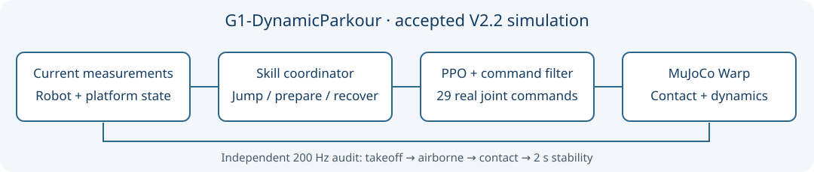

# G1-DynamicParkour

[English](README.md) · [复现指南](docs/REPRODUCTION.md) · [能力与失败](docs/RESULTS.md) · [发布前审计](audit/PRE_PUBLICATION_AUDIT.md)

基于 mjlab、MuJoCo Warp、PyTorch 与 rsl-rl PPO 的 Unitree G1 动态平台跑酷仿真研究。系统组合已训练的跳跃、落地恢复与准备策略，通过确定性协调器完成两次真实跳跃，并使用独立 200 Hz 物理日志核验。

**当前为本地公开发行候选版，等待用户最终审核，尚未创建或发布 GitHub 仓库。** 最新已验收基线为 V2.2；未完成 V3 的功能不纳入本次能力声明。安装和功能复现实测见[测试记录](audit/TEST_RESULTS.md)。机器人原资产和完整渲染视频因精确来源授权链尚未闭合，暂不公开。

| 版本 | 实测场景 | 独立合格路线 |
|---|---|---:|
| V2 | 两个 2 cm 间隙；起点/中台固定、终台横向低速运动 | 77/100 |
| V2.1 | 同场景，同时定位转向与因果命令连续化 | 80/100 |
| V2.2 | 两个 **10 cm** 间隙，中台 64×100 cm，终台 60×100 cm | **76/100** |

V2.2 振幅 0.05 m、频率 0.10 Hz。24 条非合格路线包括跌倒 17、准备超时 4、其他支持 2、额外 200 Hz 物理失败 1。V2.1 合格路线中台停留中位数 12.66→7.13 秒，缩短 43.68%；整体躯干倾斜 RMS 增加 13.2%，该代价保留。独立队列未配对，不声称显著提高成功率。

本次独立WSL候选单路线1/1合格，但Windows副本同种子回放0/1不合格，原因为第二跳过早接触目标。源码和权重SHA一致，**单次成功的可重复性仍待调查**；命令退出0不代表任务成功。

工程贡献是子策略复用、基于当前状态的协调与因果连续化、完整物理事件验收、保留失败的复现实验流程。PPO、mjlab、G1 资产与仿真器属于上游工作，协调器不是学习得到的。Actor 不读未来真实轨迹；训练 Critic 的特权信息另行登记。

不宣称实机、视觉跑酷、任意高低地形、广泛动力学鲁棒性、新 RL 算法或 V3 已完成。15 cm 单跳头不能冒充 15 cm 连续双跳成绩；质量 ±10% 的历史挑战显著失效。

环境要求为 Ubuntu 22.04 / WSL2、Python 3.10、NVIDIA GPU；原设备 RTX 4060 Laptop 8 GB。完整策略入口固定 CUDA，CPU 检查仅是局部物理或逻辑测试。

安装、权重校验、最小完整回放、正式100路线命令和训练入口见[复现指南](docs/REPRODUCTION.md)。每次运行创建唯一实验目录，记录源码、配置、种子、原始日志和退出码；退出码0不能代替物理成功。

仓库仅保留核心源码、必要配置、仿真落地数据、代表性验收证据、结构示意图和审计。十个部署/构造先验/基线 checkpoint 单独组织成 Release Assets，建立依赖与 SHA256。完整视频在本地待授权素材区，不列入允许发布清单。虚拟环境、缓存、vendor、机器身份日志和历史大归档不进入 Git。

原创代码及已授权原创参数采用 [MIT](LICENSE)，第三方见 [THIRD_PARTY_NOTICES](THIRD_PARTY_NOTICES.md)。署名暂用 G1-DynamicParkour contributors；[CITATION.cff](CITATION.cff) 不虚构个人身份、论文、DOI 或仓库地址。
