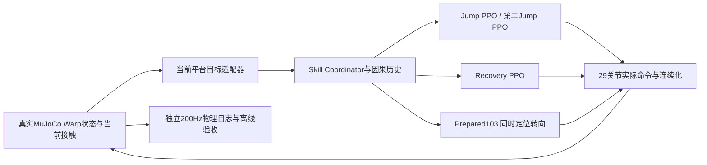

# G1-DynamicParkour V2.1 / V2.2 技术报告

## 已实测结论与范围

V2.1 在与V2相同场景的新100次独立完整路线中合格80次，中间停留中位数12.66→7.13秒，缩短43.68%；命令突变p95下降62.64%，真实关节位置二阶差分RMS下降50.85%。V2.2 在10/10cm真实间隙、中台64×100cm、终台60×100cm的新场景中，另100次独立路线合格76次。V2为两个2cm间隙、100cm宽台。两跳和所有原物理判据保持，未用reward代替成功。

扩大平台中心距离的10/15cm布局仍保留真实失败；当前有限支撑布局不等于最大跳远距离提升，也不宣称随机高低地形、视觉或实机。旧布局开发、定向PPO和真实失败全部保留。V2.2最终几何：两处真实间隙10/10cm；中台长64cm宽100cm；终台长60cm宽100cm；V2为2/2cm、80×100cm中台和60×100cm终台；动态A5cm/f0.1Hz；中台支撑面积较V2减少20%，终台支撑面积减少0%，并不宣称已经覆盖随机高低地形、视觉或实机。V1的15cm单跳验收不能冒充V2.2连续双跳。

最终V2.2首跳复用V1已验收15cm单跳头，其余V2.1准备/恢复/命令连续化保持；实际验收地形为10/10cm双间隙，不把单跳模型名称冒充15cm双跳成绩。

本报告的仿真结论已由原始数据重算。Windows复制、逐SHA、ZIP实际解包、视频/权重和本地副本回放的最终状态，读取交付根目录 `WINDOWS_FINAL_VERIFICATION.json`；制作归档本身不等同于Windows交付通过。

## 1. 继承资产与工程边界

项目：mjlab1.6.0 / MuJoCo Warp / PyTorch / rsl-rl PPO，自由基座Unitree G1、29个实际关节，RTX4060 Laptop 8GB。沿用已验证WSL环境，不重装全局Python/CUDA，不从零训练。原main及V1/V2代码、权重、实验、视频和报告保留；研发分支为 `v21-v22/continuous-parkour-20261014T152555265Z`。三条原用户未跟踪启动记录已保护、未混入本次提交。

Windows负责编排和查看，唯一编辑源在WSL ext4，所有Python/仿真/训练/视频在WSL执行；最终必要成果真实复制至Windows普通目录，排除venv和无关历史大归档。配置与训练的父权重、构造先验不可遗漏，路径及SHA由资产闭包索引固定。

## 2. 系统架构

| 模块 | 对应代码/接口 | 职责 |
|---|---|---|
| 三平台与驱动 | `course_scene.CourseGeometry / attach_course_scene` | 固定start/middle与真实滑轨动态end，真实碰撞/摩擦/动力学 |
| 当前目标 | `PlatformTargetProvider.current / relative / relative_feet` | 当前平台中心、速度、足FK和边界；不输入未来轨迹 |
| 技能协调 | `skill_coordinator.SkillCoordinator` | Jump→Recovery→Prepared103→Recovery→第二Jump→EndRecovery，只切换目标/公开clock |
| 指令连续化 | `command_continuity.JointCommandContinuity` | 准备阶段因果EMA、技能切换渐变，作用于命令而非物理状态 |
| 训练 | `train_turn_locomotion.py`、`train_prepare_settle_recovery.py`、`train_end_recovery.py` | 复用PPO与真实reset bank，仅子任务微调 |
| 完整路线 | `evaluate_course.py` | 起点一次reset、独立种子/相位、原始命令与实际驱动逐项核对 |
| 独立物理 | `course_contact_env.py`、`audit_course.py` | 三面接触、200Hz飞行/安全、稳定、时间、轨迹、碰撞box及实际gap离线核验 |
| 便携复现 | `reproduce_course_release.py` | 显式解释器、权重SHA、强制本副本src，真实回放后自动独立审计 |

Jump为25Hz源动作、两个50Hz管理步保持；Recovery和准备为50Hz；真实物理步为200Hz。协调器只读取当前Actor、足FK、自身过去动作及支持历史，不读取验收FSM。第二Jump只切换当前目标与技能clock，物理平台相位/轨迹不中断，机器人qpos/qvel、关节状态、动作历史均不中途重置。

## 3. MDP、迁移与RL设计

Jump/Recovery Actor114由99维本体及历史动作、当前目标相对位姿/速度6、公开时钟1和无身份接触/力8组成。训练Critic130保留已登记特权任务/几何信息；部署不调用Critic。Jump的30维源概率动作通过已有映射成为29维实际关节命令；PPO仍使用原源高斯概率空间，不把限幅映射后的动作当成原样本重算概率。

准备Actor99→103增加当前起跳目标在body水平坐标的XY误差和yaw sin/cos四维；Critic113→115增加当前XY信息。新增输入列零初始化、原MLP列与归一化统计继承；命令统计校准补偿首层bias，校验初始均值保持。Actor只使用当前可测状态，没有未来平台轨迹。仿真当前状态可测假设尚未被视觉/状态估计器验证。

Prepared103将同时转向/定位反馈与实际CommandManager统一：中台中心X+0.2m为当前起跳目标，位置反馈增益1.6、每轴限幅0.25m/s，yaw限幅0.8rad/s。先前Actor看到目标停止、部分奖励却追踪随机前进命令的接口错配已修复；不能只凭reward上升解释动作质量。

PPO复用真实rsl-rl更新，256env×48个50Hz步、固定学习率1e-4；微调只改变当前任务所需策略，站立先验冻结，fresh optimizer与iteration0明确登记。先做四环境100步输入/动作密度/物理只读闸门，再烟测8/16更新，再固定更新末次权重。训练reset bank由真实完整路线采集，仅子episode起点恢复；所有训练回合明确不属于完整双跳验收。

密集奖励继承姿态/速度/动作变化，并加入当前目标朝向、位置、进度、平台边界和躯干roll/pitch角速度及平面重力投影。yaw是必要转向，不能用惩罚三轴角速度的方式抹掉任务需求。持续项经实际RewardManager乘dt一次；一次事件bonus用±50/dt，仅触发一个控制步。各权重、累计项、episode时长、原始stdout/stderr和源快照保留。

V2.2曾定向训练接管Recovery：源数据来自10cm完整路线真实final_settle和安静起跳状态。首帧接触历史与部署一致，关闭训练继承的观测扰动以匹配确定性控制输入，概率密度和初始输入误差独立验证。旧训练误把控制允许的X误差≤8cm/yaw≤0.35rad收紧为4cm/0.1rad、追逐精确root点，导致安静真实状态均不计成功；改为原控制容许域只影响训练奖励/子目标，完整物理标准不变。修改后的子任务成功率不可与旧定义的0成功作同标准因果比较，也不能代替完整路线成绩。该组中间准备接管Recovery在完整10cm路线仍不足，最终V2.2没有采用这些中间接管权重。

最终EndRecovery仍沿用V2已验收权重，具体路径/SHA及未采用试验以资产索引和实际训练日志为准。

## 4. V2.1动作流畅性优化

原V2串行转向、刹停、定位、再次稳定产生重复抬腿和长等待。最终用Prepared103同时转向/定位；实际命令EMA为 `u_t=0.7*a_t+0.3*u_(t-1)`，episode独立清历史，技能切换80ms渐变。到达当前合法双足支持、稳定、X与yaw捕获条件才切原Recovery，再满足原起跳契约启动第二Jump。准备到Recovery的yaw捕获0.1→0.2rad减少重复等待，最终起跳仍≤0.35rad，独立AIR/着陆/2s标准没有修改。

中间停留定义为首次合法middle target_contact到第二段真实AIR之前最后一次takeoff。准备中短暂离足后回到supported不算第二跳提前完成；未AIR回合保留删失和失败。动作指标是每条完整路线实际29维归一化命令差分及真实关节位置差分，二阶差分单位rad，不冒称连续时间加速度。

| 独立物理合格路线统计的中位值 | V2 | V2.1 | 变化 |
|---|---:|---:|---:|
| 完整成功/全部独立路线 | 77/100 | 80/100 | 仅确认≥70%，不声称显著成功率提升 |
| 中台停留 | 12.66s | 7.13s | −43.68% |
| 关节命令一阶差分p95 | 1.570675 | 0.586861 | −62.64% |
| 命令二阶差分RMS | 0.746355 | 0.248321 | −66.73% |
| 真实关节位置二阶差分RMS | 0.044856rad | 0.022048rad | −50.85% |
| 路线级技能切换突变 | 0.609735 | 0.339421 | −44.33% |
| 总体躯干倾斜RMS | 6.986° | 7.909° | +13.2%，代价保留 |
| 中台首次稳定后的足部支持释放次数 | 76 | 21 | −72.37%，接触抖动代理，含合法步态 |
| 越过1cm高度的抬足事件次数 | 4 | 7 | 增加，不声称所有抬足减少 |
| 越过4cm高度的抬足事件次数 | 0 | 1 | 增加，包含任务所需步态/起跳准备 |

停留减少bootstrap95%区间为42.80%–44.74%，以完整路线为单位重采样。准备窗口roll/pitch角速度逐步变化RMS0.352678→0.217605rad/s（−38.3%），累计倾斜变化103.829→29.155°；部分幅度/频段仍变差。有限窗口FFT只作探索，不能把频谱泄漏或更短窗口误作所有抖动消失。

足部指标使用首段稳定后至真实第二离台的窗口：支持释放按middle足接触5N阈值由真到假计数；1cm/4cm抬足按真实足高越阈计数，均非人工标注的异常动作。释放次数减少支持接触更连贯，但不能等同所有真实抬腿减少；高度阈值事件实际增加，保留这一代价。

动作统计条件化于各版本独立物理合格路线，并单列全部失败/删失；成功率分母仍100，不能从动作样本筛选反推成功率。20个V2.1失败为fallen15、准备超时2、首段其他支持2、首段着陆后返回源台1。原速同seed70000并排视频保留完整等待，短片结束黑底明确标注，不用冻结帧延长物理稳定。

## 5. V2.2复杂地形过程与真实失败

| 阶段 | 实际结果 | 结论 |
|---|---|---|
| 5cm、原宽100cm直接复用 | 开发独立2/2 | 仅能力烟测，不是正式成功率 |
| 10cm直接复用V21 | 0/2 | 原首跳/恢复分布不匹配 |
| 10cm改V1已验收15cm首跳 | 0/2，两个首段均稳定 | 主要新瓶颈为中间准备与接管 |
| 10cm目标lane统一 | 0/2；后续真实bank开发2/8 | 修接口后仍需完整验证 |
| 10cm接管Recovery固定300 | 已知回归0/2 | 位置奖励变好不等于安静接管 |
| 降低探索噪声/原Stop/Standing接管 | 多组0/2 | 不盲目延长相同训练 |
| 对齐原接管契约+混合真实安静课程 | 子任务成功增加，完整已知回归1/2，新八仅1/8 | 不采用，不以子任务代替完整路线 |
| 旧首跳506、10cm/64cm长中台保持旧中心布局 | 独立0/2，首跳着陆后跌倒 | 有限支撑不是免费保留原能力 |
| 10cm旧串行准备+V21命令连续化 | 独立1/2；加快定位后0/2 | 单纯提速无法解决准备状态分布 |
| 15cm复用V1首跳 | 独立0/2 | 保留失败，尚未取得稳定连续双跳 |
| 5cm、70cm宽台 | 开发2/2，新八独立5/8 | 不进入正式；一条足越内缩边界导致稳定超时 |
| 先前5cm/80cm固定候选（各权重见实际配置） | 新八独立7/8；66/100，未达标保留；87/100，阶段达标保留 | 冻结评估全部保留 |
| 最终10/10cm真实间隙、中台64×100cm、终台60×100cm固定候选 | 对应新八独立6/8；正式独立76/100 | 本次验收，全部原物理判据 |

70cm台失败只读分解：一条超时路线除足边界外，姿态/速度大多数已合格；末态一足Y=-0.351985m，超过实际台和原内缩范围，inside_y满足比例仅1.26%。没有放宽边界或把“没跌倒”当成功，而是扩大真实支撑到80cm，仍比V2缩窄20%。初次窄台配置还触发了原落点安全保护；相应lane上限按宽度收紧到17/22cm，保留原双足17cm裕度，不是修改足部验收。

正式V2.2间隙为10/10cm。实际middle/end中心X为0.62/1.34m；中台长64cm宽100cm、终台长60cm宽100cm，起点仍100cm宽。 不能仅根据缩窄平台声称最大跳远距离提升。独立审计读取真实编译MuJoCo geom_type、geom_size、局部位置/姿态，再逐步用实测平台中心与实际半尺寸重算两处边缘间隙；不只信配置标签。横移A0.05m/f0.1Hz，servo kp900000/kv36000保持。

## 6. 正式物理验收与统计

V2.1种子81000..81099，V2.2种子98000..98099，各100独立完整路线，八相位区间分层抖动、关节初始位置小扰动。两组均在新八至少6/8后冻结，期间禁止换权重、场景、时限或删除失败。不同V2.2场景不能直接当作同场景单变量流畅性比较。

两段各须合法源支持→真实起跳→真实AIR→合法目标接触→连续2秒稳定。完整腾空各含至少16个连续200Hz三面无足支持样本、真实升高≥3cm；200Hz三表面非足碰撞/跌倒全程不得发生；足FK须在真实台边内缩2cm、支持力阈值5N，倾斜≤15°、平面相对速度≤0.15m/s、垂速≤0.1m/s、角速≤0.5rad/s；最终连续2秒稳定。全路线24s、准备10s、每跳+恢复12s保持。轨迹误差须小于2mm/0.01m/s，native接触交叉验证误差<0.005N，实际动作与驱动一致，所有实体直接state setter守卫及qpos/qvel只读核验无异常。

V2.2合格76/100；合格路线停留中位7.160s、命令p95中位0.572116、真实关节二阶差分中位0.021744rad。其失败统计为 `{"fallen": 17, "leg1:other_support": 2, "middle_preparation_timeout": 4, "200hz_physical_failure": 1}`，失败全部计入分母。Wilson95%区间及每路线300行原始数据见验收图/CSV，未把视频样本当独立大样本成绩。

- 先前正式完整评估：experiments/20261015T095927010825Z-v22-formal-frozen100-complex-width080-course-b0c267e3，独立66/100；状态未达标，全部保留、不混入最终候选成功率。
- 先前正式完整评估：experiments/20261015T104025094536Z-v22-formal-reused-v1-head-width080-independent100-3a2cc09b，独立87/100；状态阶段达标，全部保留、不混入最终候选成功率。

## 7. 复现、预算与可审计交付

本Goal新增PPO共15条，按实际learning monotonic计时与中断完整进程保守计时累计3070.672079588s（51.18分钟），小于21600s，无活动/未知训练。历史V2训练不重计；gate、编译、评估不冒充新增PPO。原始stdout真实提取逐迭代奖励、终止项和episode，无额外插值/平滑，保留logger原有均值与打印精度，不将不同奖励/父策略曲线作单变量因果比较。

V2.1验收：`reports/V21_ACCEPTANCE.json`；V2.2验收：`reports/V22_ACCEPTANCE.json`；V2.2正式源数据：`experiments/20261015T142903216154Z-v22-gap010-limited064-formal100-independent-course-52bfa645`，独立审计：`experiments/20261015T152117973123Z-v22-gap010-formal100-independent-physics-0e97b5ec/course_independent_audit.json`。完整权重/构造先验及配置SHA见交付资产索引，实际命令、seed、超参数、起止、Git/dirtydiff、源快照和原日志见各metadata。实验始终唯一目录，失败和中断保留。

Windows顶层README给出显式WSL解释器和本地`${LOCAL_PATH} wheel与G1资源、requirements锁定、源码历史bundle，不复制venv。正式100复跑、演示短回放、V21定向PPO训练的入口分开；重新训练不保证逐位相同参数，跨GPU版本也不预填相同成功率。

Windows副本已实测：V2.1首次seed70000失败，预先固定追加81000/81001为1/2；V2.2首次97000失败，固定追加98000/98001为2/2。所有尝试、200Hz独立审计和实际本地包导入路径均保留在WINDOWS_LOCAL_REPLAY_VALIDATION.json及project/experiments/windows-local新实验；不混入原正式100次，不保证GPU逐位重放。媒体检查入口最初误用缺失的ffprobe已保存错误，改用现成imageio FFmpeg绝对路径，无环境重装。最终校验外置收据记录修复后实际结果。

全部核心文件复制后逐SHA与字节核对，ZIP在Windows真正解包再逐SHA，演示视频必须完整解码、全部提供PT必须真实torch.load且tensor有限。Windows副本自身src完整双跳回放与独立审计作为最后验证；最终状态及ZIP自身SHA由ZIP旁外置收据证明，不能由源暂存manifest或单次exit0代替。

## 8. 当前局限与后续最关键方向

当前成果为固定同高三平台、低速横移终点、有限支撑面的仿真闭环，没有感知噪声/视觉、随机高低落差、实机验证或安全保证。扩大平台中心距离的10/15cm布局失败仍说明技能分布和接管鲁棒性不足，不能将局部PPO高成功率外推为整链能力。后续应优先从实际10cm首跳后恢复/准备状态采集更广课程，逐个核对目标、命令、动作单位与支撑契约，再定向微调；下一阶段扩大中心距离前，先验证接管鲁棒性，再逐项增加视觉或随机地形。
